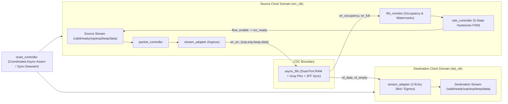

# Adaptive Rate-Matching Engine ASIC Subsystem

A synthesizable SystemVerilog RTL and verification portfolio project implementing a dual-clock **packetized adaptive rate-matching subsystem** for high-speed networking ASICs.

---

## 1. Project Motivation & Problem Statement

In high-speed switches, NICs, and SoC fabrics, ingress and egress pipelines frequently run on **independent clocks** whose effective data rates diverge due to plesiochronous offsets, frequency ratios (e.g., `125 MHz` vs `83 MHz`), bursty arrivals, and downstream backpressure.

**Core Engineering Principle:** Hardware cannot dynamically alter physical clock frequencies inside a streaming datapath. Instead, this subsystem adapts **effective data flow** across two asynchronous clock domains using:
- Elastic dual-clock buffering (`async_fifo`)
- CDC-safe local occupancy estimation (`fifo_monitor`)
- Hysteresis-based source flow control (`rate_controller`)
- Atomic packet-boundary preservation across the CDC boundary (`stream_adapter` + `packet_controller`)

---

## 2. System Architecture



Detailed specifications:
- [docs/architecture.md](docs/architecture.md)
- [docs/design.md](docs/design.md)
- [docs/cdc.md](docs/cdc.md)
- [docs/reset_strategy.md](docs/reset_strategy.md)

---

## 3. Adaptive Rate-Control & Hysteresis FSM

`rate_controller.sv` observes `src_occupancy` (`wr_ptr_bin - rd_ptr_bin_sync`) and modulates `flow_enable` (registered, no combinational loop with `src_valid`):

| State | Entry Condition | Pacing Duty Cycle | Exit Hysteresis |
|---|---|---|---|
| `CTRL_NORMAL` | Default / nominal band | 100% | Enters `THROTTLE` (`>=768`), `CONGESTION` (`>=928`), or `STARVATION` (`<=256`) |
| `CTRL_STARVATION_WARNING` | `occ <= 256` | 100% (warns only) | Exits to `NORMAL` when `occ > 384` |
| `CTRL_THROTTLE` | `occ >= 768` | 50% (`1/2` cycles) | Exits to `RECOVERY` when `occ < 640` |
| `CTRL_CONGESTION` | `occ >= 928` | <=25% (`1/4`, `0` if full) | Steps down to `THROTTLE` when `occ <= 768` |
| `CTRL_RECOVERY` | Exiting `THROTTLE` | 75% (`3/4` cycles) | Exits to `NORMAL` when `occ <= 512` |

---

## 4. Asynchronous FIFO & CDC Strategy

- **Gray-coded pointers (`rtl/async_fifo.sv`):** `g = b ^ (b >> 1)` guarantees 1-bit transitions across `SYNC_STAGES` (default 2) `ASYNC_REG` flip-flop synchronizers.
- **Full & Empty Detection:** Standard Cummings MSB/2nd-MSB inversion for `wr_full`, Gray pointer equality for `rd_empty`, both registered on their respective clocks.
- **Conservative Occupancy:** Each domain converts its synchronized remote Gray pointer back to binary locally—never sampling an unsynchronized multi-bit counter across domains.
- **Atomic Packet Boundaries:** `{packet_start, packet_end, keep, data}` (74 bits) are stored together in the FIFO word, eliminating cross-domain control skew.
- **Coordinated Reset (`rtl/reset_controller.sv`):** Asynchronous assertion across both domains, independent synchronous release per clock, and cross-synchronized `reset_busy_src`/`reset_busy_dst` gating until both halves exit reset.

---

## 5. Verification Architecture (UVM, SVA, Functional Coverage & Regression)

- **Tier 1 (Open-Source Self-Checking SV + Lint + Synthesis):**
  - `tests/tb_async_fifo.sv` — Standalone FIFO CDC unit testbench (2,282 beats, 5 clock ratios, Gray-code invariant check, overflow/underflow/reset checks).
  - `tests/tb_top.sv` — Full subsystem testbench with independent reference scoreboard, latency/throughput instrumentation, protocol stability checks, and 15 named tests.
  - `scripts/run_regression.py` — Automated multi-seed Python regression runner.
- **Tier 2 (IEEE 1800.2 UVM 1.2 + SVA + Functional Coverage):**
  - `tb/uvm/` — Modular `source_agent`, `destination_agent`, `virtual_sequencer`, independent `rate_reference_model`, `rate_scoreboard`, `rate_coverage`, constrained-random sequences, and 15 UVM test classes.
  - `tb/assertions/assertions.sv` — Bound SVA (`rate_engine_sva`) verifying valid/ready hold stability, no write-when-full / read-when-empty, reset masking, packet SOP/EOP framing, and hysteresis invariants.
  - See [docs/verification_plan.md](docs/verification_plan.md) and [docs/coverage_closure.md](docs/coverage_closure.md).

---

## 6. Reproducible Build, Lint, Simulation & Synthesis Commands

### Prerequisites
- **Icarus Verilog 13.0+** (`iverilog`, `vvp`)
- **Verilator 5.0+** (`verilator` / `verilator_bin`)
- **Yosys 0.60+** (`yosys`, optional for synthesis)
- **Python 3.10+** with `matplotlib` (for experiments & plots)
- *(For `tb/uvm/` + SVA/covergroups)*: UVM 1.2-capable simulator (Questa, VCS, or Xcelium)

### Quick Start
```bash
# 1. Lint full RTL with Verilator (0 warnings/errors)
verilator --lint-only -Wall -Irtl --top-module top \
  rtl/rate_engine_pkg.sv rtl/reset_controller.sv rtl/packet_controller.sv \
  rtl/stream_adapter.sv rtl/async_fifo.sv rtl/fifo_monitor.sv \
  rtl/rate_controller.sv rtl/top.sv

# 2. Run standalone async_fifo CDC unit testbench
iverilog -g2012 -Wall -I rtl -o sim/tb_async_fifo.vvp rtl/async_fifo.sv tests/tb_async_fifo.sv
vvp sim/tb_async_fifo.vvp

# 3. Run full subsystem testbench across all 15 tests
iverilog -g2012 -Wall -I rtl -s tb_top -o sim/tb_top.vvp \
  rtl/rate_engine_pkg.sv rtl/reset_controller.sv rtl/packet_controller.sv \
  rtl/stream_adapter.sv rtl/async_fifo.sv rtl/fifo_monitor.sv \
  rtl/rate_controller.sv rtl/top.sv tests/tb_top.sv
vvp sim/tb_top.vvp +TEST=all +SEED=20261110

# 4. Run automated Python regression (30 randomized seeds)
python scripts/run_regression.py --tests all --runs 30

# 5. Run controlled experiments A-E and generate real plots
python scripts/analyze_results.py
python scripts/plot_results.py

# 6. Run Yosys RTL synthesis & cell/memory stats
yosys -s synthesis/synth_yosys.ys
```

---

## 7. Verified Tool & Performance Results

- **Verilator 5.050 `--lint-only -Wall`:** `0` warnings, `0` errors across all 9 RTL modules.
- **Icarus Verilog `tb_async_fifo.sv`:** `PASS` (`2,282` written, `2,272` read, `10` reset-discarded, `0` errors).
- **Python Regression (`run_regression.py --tests all --runs 30`):** **`30 / 30` PASS** (`0` failures, `4.08s`).
- **Yosys 0.66 Synthesis (`top`, `FIFO_DEPTH=1024`, `DATA_WIDTH=64`):** Infers `1` dual-port `$mem_v2` (`1024 x 74 = 75,776` bits) and `246` coarse RTL cells.
- **Controlled Experiments A–E (`results/exp_*.csv`, `results/*.png`):**
  - Adaptive hysteresis (`adapt_mode=2`) matched peak egress throughput (**`2,519.87 Mbps`**) while reducing latency vs unthrottled bypass, whereas fixed-threshold cutoff (`adapt_mode=1`) suffered a **10.9% throughput drop** (`2,245.75 Mbps`) due to threshold chatter.
  - Full tables and analysis: [docs/performance_analysis.md](docs/performance_analysis.md).

---

## 8. Additional Documentation

- [docs/tradeoffs.md](docs/tradeoffs.md) — Silicon area, latency, throughput, watermark, hysteresis, and scheduling tradeoffs.
- [docs/interview_questions.md](docs/interview_questions.md) — 52 ASIC design & verification interview Q&As tied directly to this codebase.
- [docs/coverage_closure.md](docs/coverage_closure.md) — Honest simulator scope, coverage closure plan, and legitimate exclusions.

---

## 9. Limitations & Future Work

- **Limitations:** `FIFO_DEPTH` must be a power of 2 for standard Gray symmetry; single shared FIFO can experience head-of-line blocking under mixed traffic classes; full UVM `covergroup` merging requires a commercial UVM simulator (Questa/VCS/Xcelium).
- **Future Work:** APB/AXI4-Lite CSR block for dynamic runtime watermark updates, multi-QoS virtual channels with Deficit Round-Robin arbitration, and PDK-specific ASIC static timing closure.
