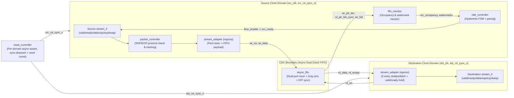

# Adaptive Rate-Matching Engine — Architecture & Verification Blueprint

## 1. Architectural Principle & Motivation

High-speed networking ASICs routinely bridge subsystems operating on independent, plesiochronous, or ratio-mismatched clocks (e.g., SerDes/MAC ingress clock vs. packet-processing core clock, or ingress vs. egress switch-fabric clocks).

**Core Principle:** Digital hardware cannot dynamically alter physical clock frequencies inside a rate-matching datapath. Instead, the **Adaptive Rate-Matching Engine** adapts *effective data flow* across two asynchronous clock domains (`src_clk` and `dst_clk`) using:
1. **Elastic buffering** (`async_fifo`) to absorb short-term bursts and rate mismatch.
2. **CDC-safe occupancy estimation** (`fifo_monitor`) derived from synchronized Gray-coded pointers.
3. **Hysteresis-based source flow control** (`rate_controller`) that modulates `src_ready` backpressure cleanly without combinational loops or threshold oscillation.
4. **Packet-boundary preservation** by packing `{packet_start, packet_end, keep, data}` into the same FIFO word so control metadata crosses the CDC boundary atomically with its data beat.

---

## 2. System Architecture Diagram



---

## 3. Module Hierarchy

### Synthesizable RTL (`rtl/`)
```text
top (rate_matching_engine_top)
├── reset_controller       # Independent domain reset synchronizers + coordinated reset status
├── packet_controller      # Source-side packet framing checker (SOP/EOP/reset-in-packet)
├── stream_adapter         # Ingress FIFO write bridge + Egress 2-entry skid/output controller
├── async_fifo             # Dual-clock Gray-coded asynchronous FIFO (synthesizable generic RTL)
├── fifo_monitor           # CDC-safe occupancy estimation, min/max tracking, watermark & err flags
└── rate_controller        # 5-state hysteresis FSM generating glitch-free source throttling
```

### Verification Hierarchy (`tb/`)
```text
tb/
├── interfaces/
│   └── stream_if.sv       # Valid/ready/data/keep/packet_start/packet_end interface + modports
├── assertions/
│   └── assertions.sv      # Protocol stability, FIFO invariants, hysteresis & packet SVA
└── uvm/
    ├── agents/            # source_agent & destination_agent (sequencer, driver, monitor)
    ├── sequences/         # stream_transaction + directed/burst/backpressure/stress sequences
    ├── reference_model/   # Independent transaction-level golden stream/packet predictor
    ├── scoreboard/        # Beat-by-beat & packet-by-packet comparator with diagnostic reporting
    ├── coverage/          # Functional covergroups & cross-coverage bins
    ├── env/               # rate_engine_env + virtual_sequencer
    └── tests/             # Directed + constrained-random UVM test suite
```

---

## 4. Signal & Interface Specification

### Parameters (`top.sv` / `rate_engine_pkg.sv`)
| Parameter | Default | Description |
|---|---:|---|
| `DATA_WIDTH` | `64` | Data bus width in bits (multiple of 8) |
| `KEEP_WIDTH` | `DATA_WIDTH/8` | Byte-enable width |
| `FIFO_DEPTH` | `1024` | Async FIFO depth (must be a power of 2, >= 16) |
| `SYNC_STAGES` | `2` | Flip-flop synchronizer stages (>= 2) |
| `CRIT_LOW_WATERMARK` | `64` | Starvation-critical threshold |
| `LOW_WATERMARK` | `256` | Low occupancy / starvation-warning threshold |
| `RECOVERY_WATERMARK` | `512` | Hysteresis exit threshold from `RECOVERY` to `NORMAL` |
| `HIGH_WATERMARK` | `768` | Threshold to enter `THROTTLE` |
| `CRIT_HIGH_WATERMARK` | `928` | Threshold to enter `CONGESTION` |

### Streaming Interface (`stream_if.sv`)
| Signal | Width | Direction (Source -> Sink) | Semantics |
|---|---:|---|---|
| `clk` | 1 | Input to both | Domain clock (`src_clk` or `dst_clk`) |
| `rst_n` | 1 | Input to both | Domain synchronized active-low reset |
| `data` | `DATA_WIDTH` | Source -> Sink | Beat payload |
| `keep` | `KEEP_WIDTH` | Source -> Sink | Byte valid mask |
| `valid` | 1 | Source -> Sink | Producer has valid beat on bus |
| `ready` | 1 | Sink -> Source | Consumer can accept beat on this rising `clk` |
| `packet_start` | 1 | Source -> Sink | Asserted on first beat of packet (SOP) |
| `packet_end` | 1 | Source -> Sink | Asserted on last beat of packet (EOP) |

**Handshake Rule:** Transfer occurs iff `valid && ready` on `posedge clk`. When `valid && !ready`, producer must hold `data`, `keep`, `packet_start`, and `packet_end` unchanged until `ready == 1`.

### Status & Error Interface (`top.sv`)
- **Write/Source domain (`src_clk`):** `fifo_full`, `almost_full`, `congestion`, `starvation_warning`, `overflow_error`, `packet_error`, `current_state[2:0]`, `src_occupancy[$clog2(FIFO_DEPTH):0]`, `max_occupancy`, `min_occupancy`.
- **Read/Destination domain (`dst_clk`):** `fifo_empty`, `almost_empty`, `underflow_error`, `dst_occupancy[$clog2(FIFO_DEPTH):0]`.

---

## 5. Adaptive Rate Controller FSM Design (`rate_controller.sv`)

The controller runs synchronously on `src_clk` and produces a registered `flow_enable` signal that gates `src_ready` (`src_ready = !fifo_full && flow_enable && !src_in_reset`).

### States (`ctrl_state_e`)
1. `CTRL_NORMAL (3'd0)`: `flow_enable = 1` every cycle (100% bandwidth).
2. `CTRL_STARVATION_WARNING (3'd1)`: Occupancy `< LOW_WATERMARK`; `flow_enable = 1` every cycle, `starvation_warning = 1`.
3. `CTRL_THROTTLE (3'd2)`: Occupancy `>= HIGH_WATERMARK`; duty-cycle pacing (e.g., 50% duty cycle: allow 1 beat per 2 cycles).
4. `CTRL_CONGESTION (3'd3)`: Occupancy `>= CRIT_HIGH_WATERMARK`; aggressive pacing (e.g., 25% duty cycle: allow 1 beat per 4 cycles or pause above `FIFO_DEPTH - margin`), `congestion = 1`.
5. `CTRL_RECOVERY (3'd4)`: Entered when leaving `THROTTLE`/`CONGESTION` once occupancy falls below `HIGH_WATERMARK - HYSTERESIS`; uses 75% duty cycle (3 out of 4 cycles) until occupancy drops to `<= RECOVERY_WATERMARK`, preventing rapid chatter/oscillation around `HIGH_WATERMARK`.

### Hysteresis State Transitions
```text
CTRL_NORMAL
  ├─ occ < LOW_WATERMARK         -> CTRL_STARVATION_WARNING
  ├─ occ >= CRIT_HIGH_WATERMARK  -> CTRL_CONGESTION
  └─ occ >= HIGH_WATERMARK       -> CTRL_THROTTLE

CTRL_STARVATION_WARNING
  ├─ occ >= HIGH_WATERMARK       -> CTRL_THROTTLE
  └─ occ >= LOW_WATERMARK + HYST -> CTRL_NORMAL

CTRL_THROTTLE
  ├─ occ >= CRIT_HIGH_WATERMARK  -> CTRL_CONGESTION
  └─ occ <= RECOVERY_WATERMARK   -> CTRL_RECOVERY (or if < HIGH - HYST -> CTRL_RECOVERY)

CTRL_CONGESTION
  └─ occ < HIGH_WATERMARK        -> CTRL_THROTTLE (step-down) / CTRL_RECOVERY

CTRL_RECOVERY
  ├─ occ >= CRIT_HIGH_WATERMARK  -> CTRL_CONGESTION
  ├─ occ >= HIGH_WATERMARK       -> CTRL_THROTTLE
  └─ occ <= RECOVERY_WATERMARK   -> CTRL_NORMAL
```
*(Exact hysteresis constants are parameterized in `rate_controller.sv` so recovery requires crossing a distinct lower threshold before returning to `CTRL_NORMAL`.)*

---

## 6. Asynchronous FIFO Design (`async_fifo.sv`)

- **Pointer Width:** For `FIFO_DEPTH = 2^N`, binary pointers `wr_ptr_bin` and `rd_ptr_bin` are `(N+1)` bits wide. Lower `N` bits index the memory array; MSB distinguishes wrap-around parity.
- **Gray Coding:** `g = b ^ (b >> 1)`. Adjacent binary increments change **exactly 1 bit** in Gray code, eliminating multi-bit skew corruption when sampled asynchronously by the opposite clock domain.
- **Synchronization:** `wr_ptr_gray` passes through a `SYNC_STAGES`-deep flip-flop chain clocked by `rd_clk`; `rd_ptr_gray` passes through a `SYNC_STAGES`-deep flip-flop chain clocked by `wr_clk`.
- **Empty Detection (`rd_clk`):** `rd_empty_next = (rd_ptr_gray_next == wr_ptr_gray_sync)`. Registered into `rd_empty`.
- **Full Detection (`wr_clk`):** `wr_full_next = (wr_ptr_gray_next == {~rd_ptr_gray_sync[N:N-1], rd_ptr_gray_sync[N-2:0]})`. Registered into `wr_full`.
- **Conservative Occupancy:** Each domain converts the incoming synchronized Gray pointer back to binary (`gray2bin`).
  - Write domain computes `wr_occ = wr_ptr_bin - rd_ptr_bin_sync`. Because `rd_ptr_bin_sync` lags the true read pointer by `SYNC_STAGES` cycles, `wr_occ >= true_occupancy` (conservative upper bound — triggers backpressure early, never risks overflow).
  - Read domain computes `rd_occ = wr_ptr_bin_sync - rd_ptr_bin`. Because `wr_ptr_bin_sync` lags the true write pointer, `rd_occ <= true_occupancy` (conservative lower bound — never risks underflow).

---

## 7. CDC & Reset Strategy

### Explicit CDC Crossings
1. `wr_ptr_gray` (`wr_clk` -> `rd_clk`): 2FF/N-FF Gray synchronizer inside `async_fifo`.
2. `rd_ptr_gray` (`rd_clk` -> `wr_clk`): 2FF/N-FF Gray synchronizer inside `async_fifo`.
3. `src_rst_n` / `dst_rst_n` -> synchronized resets (`src_rst_sync_n`, `dst_rst_sync_n`): Async-assert, synchronous-deassert 2FF reset synchronizers in `reset_controller`.
4. Packet metadata (`packet_start`, `packet_end`, `keep`): Bundled with `data` inside the single FIFO memory word (`{packet_start, packet_end, keep, data}`), eliminating parallel CDC skew.
5. Error/Reset status flags (if cross-domain visibility needed): Synchronized via pulse-toggle or 2FF level synchronizers.

### Reset Safety
- Asynchronous assertion puts pointers, full/empty flags, and FSMs immediately into known safe values (`full=0` or safe-masked during reset, `empty=1`, `valid=0`, `ready=0`).
- Synchronous deassertion releases reset synchronously to each domain's own clock edge, avoiding recovery/removal metastability.
- While either domain is in reset, `reset_controller` coordinates a cross-domain reset-active mask (`src_ready = 0`, `dst_valid = 0`) so neither side writes into or reads out of a half-reset FIFO.

---

## 8. Verification Architecture & Plan

### Two-Tier Verification Strategy
1. **Tier 1 (Open-Source SV Self-Checking Testbenches — Verilator / Icarus Verilog):**
   - Standalone `async_fifo` directed + randomized CDC stress testbench (Phase 3).
   - Full subsystem self-checking SV testbench with scoreboard, clock-ratio sweeps, bursts, backpressure, and CSV trace logging for Python performance analysis (Phase 7).
2. **Tier 2 (Full UVM + SVA + Functional Coverage — `tb/uvm/` & `tb/assertions/`):**
   - Modular UVM environment (`source_agent`, `destination_agent`, `virtual_sequencer`, `reference_model`, `scoreboard`, `coverage`) targeting UVM 1.2 simulators (Questa/VCS/Xcelium).

### Verification Matrix
| Category | Scenarios |
|---|---|
| Clock Ratios | `100/80 MHz`, `80/100 MHz`, `100/100 MHz`, `150/75 MHz`, `125/83 MHz` (non-integer) |
| Traffic Profiles | Continuous, short bursts (1–8), long bursts (100–1000), idle gaps, alternating, random |
| Backpressure | Always ready, bounded stall, alternating 1/0, random N-on/M-off |
| Boundaries & FSM | Empty, low/high/critical watermarks, hysteresis entry/exit, full boundary |
| Resets & Errors | Idle reset, reset mid-packet, reset near full/empty, SOP/EOP error injection, overflow/underflow attempts |

---

## 9. Repository Structure

```text
adaptive-rate-matching-engine/
├── rtl/
│   ├── rate_engine_pkg.sv
│   ├── async_fifo.sv
│   ├── fifo_monitor.sv
│   ├── rate_controller.sv
│   ├── stream_adapter.sv
│   ├── packet_controller.sv
│   ├── reset_controller.sv
│   └── top.sv
├── tb/
│   ├── interfaces/stream_if.sv
│   ├── assertions/assertions.sv
│   └── uvm/
│       ├── agents/
│       ├── sequences/
│       ├── reference_model/
│       ├── scoreboard/
│       ├── coverage/
│       ├── env/
│       └── tests/
├── tests/                 # Standalone Phase 3 & Phase 7 SV testbenches
├── scripts/               # Regression runner, result analyzer, plotter
├── sim/                   # Build & wave output area
├── synthesis/             # Yosys/ASIC synthesis scripts
├── results/               # Real simulation CSVs and plots
├── docs/                  # Architecture, design, CDC, reset, coverage, interview, tradeoffs
├── Makefile
├── README.md
└── LICENSE
```

---

## 10. Phased Implementation Plan

- **Phase 1:** Architecture, repository scaffolding, `rate_engine_pkg.sv`, `stream_if.sv` *(Current Phase)*
- **Phase 2:** `async_fifo.sv` (synthesizable Gray-coded dual-clock FIFO)
- **Phase 3:** Standalone FIFO unit testbench (`tests/tb_async_fifo.sv`) & verification
- **Phase 4:** `packet_controller.sv` & `stream_adapter.sv`
- **Phase 5:** `fifo_monitor.sv` & `rate_controller.sv` (hysteresis FSM)
- **Phase 6:** `reset_controller.sv` & `top.sv` integration
- **Phase 7:** Full subsystem self-checking SV testbench (`tests/tb_top.sv`)
- **Phase 8–10:** Reusable UVM environment, reference model, scoreboard, constrained-random tests
- **Phase 11–12:** SVA (`tb/assertions/assertions.sv`) & functional coverage (`tb/uvm/coverage/`)
- **Phase 13–14:** Python regression (`scripts/run_regression.py`) & coverage closure (`docs/coverage_closure.md`)
- **Phase 15:** Real simulation performance experiments (A–E) & Python plots


